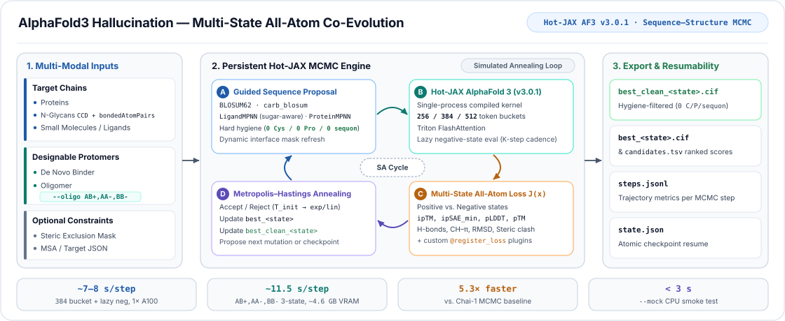
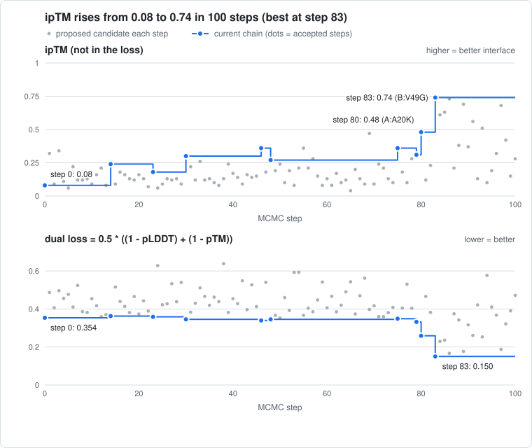
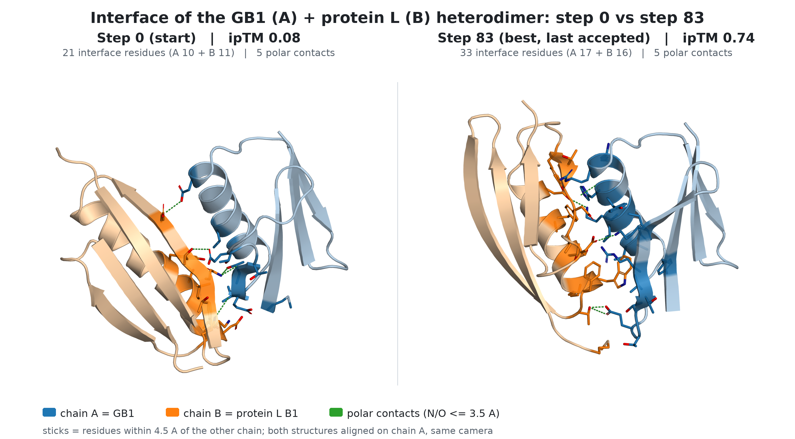

# AlphaFold3 Hallucination

**English** | [简体中文 (Chinese)](README_ZH.md)

[](https://github.com/DFan03/Alphafold3-Hallucination/actions/workflows/ci.yml)
[](pyproject.toml)
[](docs/installation.md)



---

## Purpose & Performance

### Purpose

**AlphaFold3 Hallucination** (`af3-hall`) is a standalone, multistate all-atom simulated-annealing MCMC design engine running directly inside **AlphaFold 3 (v3.0.1)**. Starting from random or seed protein sequences, it co-evolves sequence and all-atom complex structure across arbitrary positive (`+`) and negative (`-`) thermodynamic states:

- **Multistate Positive & Negative Design (`--oligo` & `states:`):** Express oligomeric specificity contrasts directly via `--oligo AB+,AA-,BB-` (`+` rewards formation of the desired heterodimer `AB`, while `-` penalizes off-target homodimers `AA` and `BB`; repeated letters share mutable protomer sequences) or define arbitrary `1..N` states in YAML.
- **True All-Atom Chemistry:** Design binders directly against fixed protein targets, **covalent N-glycan trees** (`CCD` monosaccharides linked via `bondedAtomPairs`, with built-in `A1G0F`, `A3G0`, `A3G0F`, `A3G3F`, and `A4G2F` trees or custom `sugar_nodes`), and **small-molecule CCD / SMILES ligands**.
- **Steric Exclusion & Manufacturing Hygiene:** Rigid-alignment steric clash guards (`--steric-clash-ref-cif`) prevent binders from colliding with flanking full-length receptor domains, while sequence filters enforce `0` Cys, `0` Pro (`exclude_aa: "CP"`), and `0` `N-X-S/T` glycosylation sequons (`forbid_sequon: true`).
- **Hot-JAX Persistence & Lazy Negative Evaluation:** `AF3HotRunner` loads weights and compiles token buckets once in memory (`(256, 384, 512, 768, 1024, 1536, 2048)` + disk XLA cache), pre-crops target MSAs once at startup, and skips redundant negative-state folds on rejected proposals via `--lazy-neg-interval`.

### Performance

Verified benchmarks on **1× NVIDIA A100 80 GB** (Triton FlashAttention, persistent hot-JAX session, `num_diffusion_samples: 1`):

| Workload | Configuration | Speed | Peak VRAM | Notes |
| :--- | :--- | :--- | :--- | :--- |
| **3-state *de novo* heterodimer** | `AB+,AA-,BB-`, `50+50 aa`, `num_recycles: 1` | **`11.5 s/step`** | **`~4.6 GiB`** | **`5.3×` faster** and **~50% lower VRAM** vs. equivalent `Chai-1` MCMC (`61.0 s/step`, `~9.3 GiB`) |
| **Fixed-target glycosylated complex** | `~300` tokens, `--buckets 384`, `lazy_neg_interval: 5` | **`~7–8 s/step`** | — | Avoids compiling up to the `512` bucket and skips negative folds on rejected steps |
| **CPU `--mock` mode** | `MockAF3Runner` (no GPU / no AF3 weights) | **`< 3 s`** total | `0 GiB` | Deterministic all-atom mmCIF + PAE synthesis for CI & dry runs |

---

## Installation & 5-Minute Quick Start

### 1. Install

```bash
git clone https://github.com/DFan03/Alphafold3-Hallucination.git
cd Alphafold3-Hallucination
pip install -e ".[dev]"
```

Run the unit test suite:

```bash
pytest -q tests/
```

### 2. Zero-GPU `< 3 s` `--mock` Verification

Verify the CLI, `--oligo` syntax, and all 4 tutorial YAML configs on CPU with zero GPU or AlphaFold 3 weights required:

```bash
# Multistate heterodimer dry run (3 steps on CPU)
python AF3_multistate_hallucination.py --oligo AB+,AA-,BB- --L 12,12 --steps 3 --mock

# Smoke-test every bundled example YAML
for cfg in examples/*.yaml; do
  af3-hall --config "$cfg" --mock --steps 2 --out "./ci_smoke/$(basename "$cfg" .yaml)"
done
```

### 3. Run Real AlphaFold 3 on GPU

Point environment variables to your AlphaFold 3 installation, weights, and public databases (see [docs/installation.md](docs/installation.md)), then launch a design run:

```bash
export AF3_CODE_DIR=/path/to/alphafold3
export AF3_MODEL_DIR=/path/to/af3_models
export AF3_DB_DIR=/path/to/public_databases
export AF3_JAX_CACHE_DIR=./tmp/jax_cache_af3

af3-hall --config examples/02_protein_binder_fixed_target.yaml
```

> **Tip:** `AF3_multistate_hallucination.py` and the installed `af3-hall` console script invoke the exact same CLI (`af3_hall.cli:main`).

---

## Ready-to-Run Tutorials

### Tutorial 1: *De Novo* Heterodimer (`AB+, AA-, BB-` Multistate Contrast)

Co-evolves two 50-aa protomers (`A` and `B`) to favor heterodimer `AB` (`+`) while penalizing homodimers `AA` (`-`) and `BB` (`-`) using `dual` loss and `frequency_adjusted` proposals ([examples/01_heterodimer_AB_parity.yaml](examples/01_heterodimer_AB_parity.yaml)):

```bash
# YAML config (50-aa protomers A and B, 100 MCMC steps)
af3-hall --config examples/01_heterodimer_AB_parity.yaml

# Equivalent --oligo CLI shorthand
python AF3_multistate_hallucination.py \
  --oligo AB+,AA-,BB- \
  --L 50,50 \
  --losses dual \
  --mutation-method frequency_adjusted \
  --T-init 0.01 \
  --half-life 1000 \
  --recycles 1 \
  --mask-mode all \
  --steps 100
```

Add `--mock` to either command to test end-to-end on CPU in seconds.

### Tutorial 2: Fixed-Target Protein Binder

Designs a 48-aa binder (chain `B`) against a fixed target sequence (chain `A`), restricting mutations to interface residues (`--mask-mode interface`, refreshed every 10 steps) and optimizing `ipsae_min,iptm,plddt` ([examples/02_protein_binder_fixed_target.yaml](examples/02_protein_binder_fixed_target.yaml)):

```bash
# Run bundled example
af3-hall --config examples/02_protein_binder_fixed_target.yaml

# Override target FASTA or precomputed AF3 target MSA JSON from CLI
af3-hall --config examples/02_protein_binder_fixed_target.yaml \
  target_fasta=./my_target.fasta \
  target_msa_json=./my_target_data.json \
  --steps 200
```

### Tutorial 3: Multistate Glycoprotein / N-Glycan-Specific Binder (`+glyco / -bare`)

Designs a 56-aa binder selective for an `A3G3F` tri-antennary fucosylated N-glycan anchored at `target_n_pos: 15` while contrasting against the aglycosylated receptor (`include_bare: true`) via `glyco_delta` ([examples/03_glycoprotein_binder_multistate.yaml](examples/03_glycoprotein_binder_multistate.yaml)). Uses `carb_blosum` proposals (or `ligand_mpnn_biased` when `LIGANDMPNN_DIR` is configured) and `--lazy-neg-interval 3`:

```bash
# Run with carb_blosum and lazy negative-state evaluation
af3-hall --config examples/03_glycoprotein_binder_multistate.yaml

# With full-length receptor steric-clash guard and LigandMPNN biased proposals
af3-hall --config examples/03_glycoprotein_binder_multistate.yaml \
  --mutation-method ligand_mpnn_biased \
  --steric-clash-ref-cif ./full_receptor_ref.cif \
  --steric-ref-residues 1,42 \
  steric_clash_weight=0.2
```

Supported built-in N-glycan trees: `A1G0F` (7 sugars), `A3G0` (9), `A3G0F` (9), `A3G3F` (12), `A4G2F` (11), or arbitrary custom `sugar_nodes` in `states:`.

### Tutorial 4: Small-Molecule All-Atom CCD Ligand Binder

Evolves a 60-aa protein chain (`B`) to bind an all-atom CCD ligand (`ATP` in [examples/04_small_molecule_ligand_binder.yaml](examples/04_small_molecule_ligand_binder.yaml), or swap to `HEM` / any PDB CCD code or SMILES string):

```bash
# Run the bundled ATP binder example
af3-hall --config examples/04_small_molecule_ligand_binder.yaml

# Design a heme (HEM) binder directly via key=value overrides
af3-hall \
  --job hem_binder \
  --L 60 \
  --losses ipsae_min,iptm,plddt,contact \
  --loss-weights 1.5,1.0,0.5,0.5 \
  --mask-mode interface \
  --mask-refresh-interval 10 \
  --steps 100 \
  ligand_ccd=HEM
```

### Tutorial 5: Foldable *α/β* Heterodimer from Natural Domains (GB1 + Protein L)

Instead of random starting sequences, start from two foldable α/β domains derived from natural proteins (GB1 56 aa = PDB 1PGA; protein L B1 64 aa = PDB 1HZ6 with N14D and W47Y; `0 Cys / 0 Pro / 0 sequon`) and let the MCMC build an interface between them while keeping both folds ([examples/05_foldable_heterodimer_GB1_proteinL.yaml](examples/05_foldable_heterodimer_GB1_proteinL.yaml), full write-up: [examples/05_foldable_heterodimer/](examples/05_foldable_heterodimer/README.md)).

```bash
af3-hall --config examples/05_foldable_heterodimer_GB1_proteinL.yaml
```





**Result in 100 steps (seed 0, `AB+` only, loss `dual`, `T_init 0.01`, `mutation_rate 3-1`):** ipTM `0.08 → 0.74` (best accepted step 83; ipTM is *not* in the loss), pTM `0.50 → 0.81`, pLDDT `0.79 → 0.89`, `dual` loss `0.354 → 0.150`, helix/strand content of both chains preserved, interface `44 → 88` chain-A atoms within 5 Å of chain B. First and last structures: [step 0](examples/05_foldable_heterodimer/step_0000_acc_AB_pos.cif), [step 83](examples/05_foldable_heterodimer/step_0083_acc_AB_pos.cif). **Runtime:** `628 s` for 100 steps on one A100 80 GB (median `5.9 s/step`, step 0 incl. compile `31 s`). One seed, AF3's own confidences: a demonstration, not a benchmark.

---

## Complete CLI Options Reference

All flags map directly to [src/af3_hall/cli.py](src/af3_hall/cli.py) and override values loaded from `-c/--config` or defaults in [src/af3_hall/config.py](src/af3_hall/config.py). Trailing positional `key=value` arguments override any config key in `DEFAULTS`.

| Flag (Aliases) | Default (`config.py`) | Description |
| :--- | :--- | :--- |
| `-c`, `--config` | `None` | Path to YAML or JSON run configuration file. |
| `--oligo` | `None` | Multistate oligomer shorthand, e.g. `AB+,AA-,BB-` or `A+` (clears `states` when set). |
| `--L`, `--length`, `--binder-length` | `80` | Protomer length(s), e.g. `80` or `50,50`. |
| `--losses` | `None` (→ `dual`) | Comma-separated registered loss names (e.g. `dual`, `plddt,iptm,ptm`, `glyco_delta`). |
| `--loss-weights` | `None` (→ `1.0` each) | Comma-separated weights matching `--losses`. |
| `--steps` | `100` | Number of simulated-annealing MCMC steps. |
| `--proposals-per-step` | `1` | Candidate mutants evaluated per step (best-scoring candidate enters Metropolis test). |
| `--out`, `--out-dir` | `None` | Explicit output directory (overrides `--out-root`/`<date>_af3_hall_<job>`). |
| `--out-root` | `./runs` | Root directory for date-stamped run folders (also `AF3_HALL_OUT_ROOT`). |
| `--job`, `--name` | `None` (`af3_hall_run`) | Run / job identifier used in output naming and summaries. |
| `--seed` | `0` | Master RNG seed for sequence init, proposals, and AF3 `modelSeeds`. |
| `--mock` | `False` | Shortcut for `--backend mock` (`MockAF3Runner`, zero-GPU deterministic CPU mode). |
| `--backend` | `in_memory` | AF3 execution backend: `in_memory`, `subprocess`, or `mock`. |
| `--save-trajectory` | `accepted` | A structure trajectory (`<run>/trajectory/step_NNNN_acc_<state>.cif`) is always written for accepted steps; `all` also keeps rejected candidates. |
| `--fastrelax` | `False` | tmol FastRelax of every AF3-predicted state before scoring (affects structure-derived metrics only, not AF3 confidences); see [docs/fastrelax.md](docs/fastrelax.md). |
| `--relax-scope` | `all` | `all` = whole-complex Cartesian FastRelax (~13 s per 100 residues); `shell` = backbone-fixed interface side-chain relax (~3 s). |
| `--relax-repeats` | `1` | FastRelax repeats. |
| `--mutation-method` | `blosum` | Proposal sampler: `uniform`, `frequency_adjusted`, `blosum`, `carb_blosum`, `mpnn`, `ligand_mpnn_biased`. |
| `--mutation-rate` | `"3-1"` | Residue mutations per step: constant (`"2"`), linear anneal (`"3-1"`), or uniform random (`"rand:1-3"`). |
| `--T-init`, `--t-init` | `0.05` | Initial simulated-annealing temperature. |
| `--half-life` | `50.0` | Exponential temperature half-life in steps (`temp_schedule=exp`). |
| `--temp-schedule` | `exp` | Annealing temperature schedule: `exp`, `linear`, or `const`. |
| `--recycles`, `--num-recycles` | `3` | AlphaFold 3 trunk recycles. |
| `--num-diffusion-samples` | `1` | AlphaFold 3 diffusion samples per prediction (highest `ranking_score` selected). |
| `--mask-mode` | `auto` | Mutable residue mask: `auto` (`interface` if fixed partner else `all`), `interface`, `all`, or `explicit`. |
| `--mask-refresh-interval` | `0` | Steps between interface mask refreshes (`0` = compute at step 0 only). |
| `--p-nonint` | `0.0` | Probability of sampling a position outside the mutable interface mask. |
| `--lazy-neg-interval` | `1` | Evaluate negative states (`weight < 0` or `bare`) every `N` steps or when positive state improves. |
| `--exclude-aa` | `"CP"` | Banned amino acid characters (default forbids Cys and Pro). |
| `--no-forbid-sequon` | `False` (`forbid_sequon: true`) | Disable the `N-X-S/T` (`X != P`) glycosylation sequon filter on designed chains. |
| `--allow-init-forbidden` | `False` | Allow starting sequences containing forbidden residues/sequons (purged first during proposals). |
| `--steric-clash-ref-cif` | `None` | Reference CIF/PDB path for rigid-alignment steric clash checking against full context. |
| `--steric-ref-residues` | `None` | 1-based alignment residue range (`start,end` or `start-end`) in the steric reference structure. |
| `--steric-pred-residues` | `None` | 1-based alignment residue range (`start,end` or `start-end`) in the predicted target chain. |
| `--af3-dir` | `./alphafold3` | Path to AlphaFold 3 repository (env: `AF3_CODE_DIR`). |
| `--model-dir` | `./models` | Path to AlphaFold 3 weights directory (env: `AF3_MODEL_DIR`). |
| `--db-dir` | `./public_databases` | Path to AlphaFold 3 public databases (env: `AF3_DB_DIR`). |
| `--jax-cache-dir` | `./tmp/jax_cache_af3` | Persistent JAX XLA compilation cache directory (env: `AF3_JAX_CACHE_DIR`). |
| `--mpnn-dir` | `""` | Path to ProteinMPNN / LigandMPNN repository (env: `LIGANDMPNN_DIR`). |
| `--buckets` | `[256, 384, 512, 768, 1024, 1536, 2048]` | Comma-separated AF3 token padding buckets. |
| `overrides` (positional) | `()` | Optional `key=value` overrides for any key in `DEFAULTS`. |

---

## YAML Configuration Reference

In addition to all CLI options above, YAML/JSON configs and `key=value` overrides support every key in `DEFAULTS` ([src/af3_hall/config.py](src/af3_hall/config.py)):

<details>
<summary>Expand full YAML configuration key reference (all 89 keys)</summary>

- **Paths & Environment (`DEFAULTS` / env overrides):**
  - `name` (`"af3_hall_run"`), `job` (`null`), `out_dir` (`null`), `out_root` (`"./runs"`, env `AF3_HALL_OUT_ROOT`), `tmp_root` (`"./tmp"`, env `AF3_HALL_TMP_DIR`), `log_dir` (`null`), `export_candidates_tsv` (`null`).
  - `af3_dir` (`"./alphafold3"`, env `AF3_CODE_DIR`), `model_dir` (`"./models"`, env `AF3_MODEL_DIR`), `db_dir` (`"./public_databases"`, env `AF3_DB_DIR`), `jax_cache_dir` (`"./tmp/jax_cache_af3"`, env `AF3_JAX_CACHE_DIR`).
  - `mpnn_dir` (`""`, env `LIGANDMPNN_DIR`), `mpnn_checkpoint` (`""`, env `LIGANDMPNN_CHECKPOINT`), `mpnn_python` (`sys.executable`, env `LIGANDMPNN_PYTHON`).
- **Multistate & Target / Ligand Specification:**
  - `states` (`null`): explicit list of `{name, weight, chains, [losses, loss_weights, bonded_atom_pairs, user_ccd]}` dicts.
  - `oligo` (`null`): oligomeric state shorthand (`"AB+,AA-,BB-"`).
  - `target_seq` (`null`), `target_fasta` (`null`), `target_pdb` (`null`), `target_chain` (`"A"`), `target_msa_json` (`null`).
  - `target_n_pos` (`null`), `glycoform` (`null`: `A1G0F` | `A3G0` | `A3G0F` | `A3G3F` | `A4G2F`), `include_bare` (`true`).
  - `ligand_ccd` (`null`), `ligand_smiles` (`null`).
- **Starting Sequences & Reference:**
  - `binder_seq` (`null`, comma-separated if multiple protomers), `seqs` (`null`), `seq_file` (`null`, TSV with `sequence` and optional `design_id` column), `seq_ids` (`null`), `binder_length` (`80`), `ref_cif` (`null`).
- **AF3 Runtime:**
  - `backend` (`"in_memory"`), `num_recycles` (`3`), `num_diffusion_samples` (`1`), `flash_attention` (`"triton"`), `gpu_device` (`0`), `buckets` (`[256, 384, 512, 768, 1024, 1536, 2048]`).
- **MCMC, Proposals & Masking:**
  - `seed` (`0`), `steps` (`100`), `proposals_per_step` (`1`), `T_init` (`0.05`), `half_life` (`50.0`), `temp_schedule` (`"exp"`), `T_final` (`null`), `margin` (`0.0`).
  - `mutation_method` (`"blosum"`), `mutation_rate` (`"3-1"`), `blosum_temp` (`1.0`), `wf_cap_frac` (`0.12`).
  - `mpnn_weights` (`"proteinmpnn_v_48_020"`), `mpnn_refresh_interval` (`5`), `mpnn_temp` (`0.3`).
  - `mask_mode` (`"auto"`), `interface_dist` (`6.0`), `explicit_positions` (`null`), `p_nonint` (`0.0`), `mask_refresh_interval` (`0`).
  - `lazy_neg_interval` (`1`), `lazy_bare_interval` (`null` alias), `exclude_aa` (`"CP"`), `forbid_sequon` (`true`), `allow_init_forbidden` (`false`).
- **Scoring & Steric Clash Guards:**
  - `losses` (`null`), `loss_weights` (`null`), `pae_cutoff` (`10.0`), `dist_cutoff` (`10.0`), `hbond_cutoff` (`3.5`).
  - `steric_clash_ref_cif` (`null`), `steric_clash_weight` (`0.0`), `steric_ref_residues` (`null`), `steric_pred_residues` (`null`), `steric_hv_cutoff` (`2.5`), `steric_ca_cutoff` (`3.8`).
  - `glyco_delta` / composite weights: `w1_ipsae_glyco` (`1.0`), `w2_delta_iptm` (`1.0`), `w3_delta_ipsae` (`1.0`), `w4_hbonds_glycan` (`0.05`), `w5_rmsd_core` (`0.10`), `w_glycan_contacts` (`0.0`), `w_nonstem_sugars` (`0.0`), `w_ch_pi` (`0.0`), `w_binder_plddt` (`0.0`), `w_stereo_penalty` (`0.0`), `w_rg_penalty` (`0.0`), `w_excess_target_contacts` (`0.0`), `target_max_contacts` (`14`), `w_forbidden_aa` (`0.0`).
  - `force_proposals` (`null`, deterministic test hook `{step: [seq, ...]}`).

</details>

---

## Losses, Outputs & Further Reading

- **[docs/installation.md](docs/installation.md)** — Local install, CPU `--mock` vs AlphaFold 3 v3.0.1 GPU setup, Triton FlashAttention vs `xla`, compilation buckets, persistent `AF3HotRunner`, and troubleshooting.
- **[docs/losses.md](docs/losses.md)** — Complete catalog of all 14 `@register_loss` and `@register_multistate_loss("glyco_delta")` objectives, `compute_objective_J` weights, and custom loss plugin guide.
- **[docs/fastrelax.md](docs/fastrelax.md)** — Optional `--fastrelax`: tmol FastRelax of every predicted state before scoring (whole-complex or interface side-chain scope), options, cost, limits.
- **[docs/outputs.md](docs/outputs.md)** — Output directory layout (including the always-written per-step `trajectory/` CIFs), `steps.jsonl` schema, atomic `state.json` resume, sequence hygiene (`best_clean_*`), and trajectory plotting.
