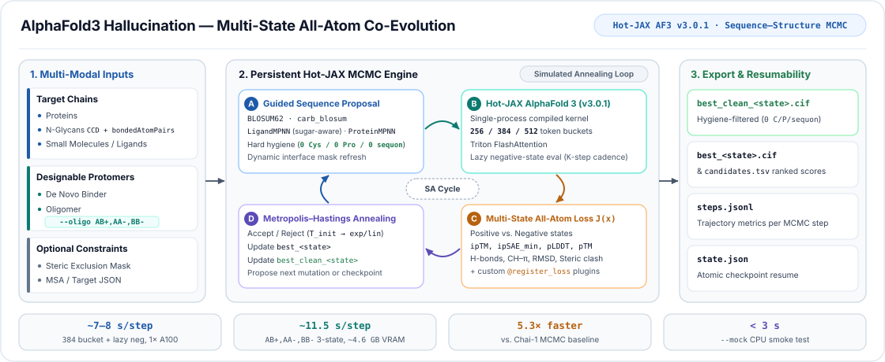
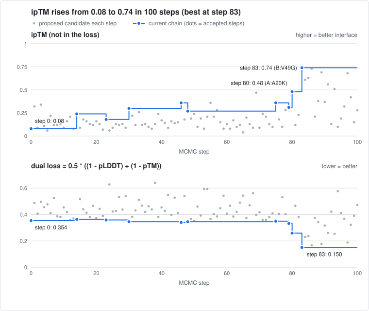
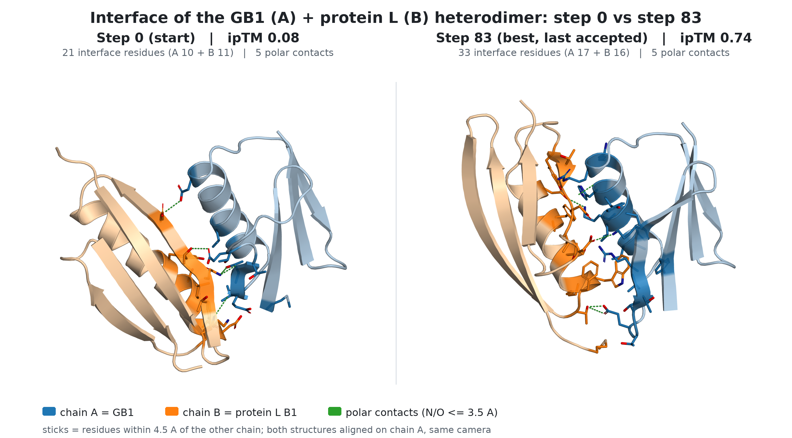

# AlphaFold3 Hallucination（中文说明）

[English](README.md) | **简体中文**

[](https://github.com/DFan03/Alphafold3-Hallucination/actions/workflows/ci.yml)
[](pyproject.toml)
[](docs/installation.md)

> **⚠️ 免责声明 / Translation Disclaimer:** 本中文文档为便利读者而提供的翻译版本，**不保证内容完全准确或与英文原版同步，使用风险自负**。所有技术细节、命令行参数与配置说明请以英文原版 [README.md](README.md) 为准。
> *(This Chinese translation is provided for convenience only; accuracy and currency are not guaranteed—use at your own risk. Please refer to [README.md](README.md) as the authoritative reference.)*



---

## 设计目标与性能表现 (Purpose & Performance)

### 设计目标 (Purpose)

**AlphaFold3 Hallucination**（包名与命令行工具：`af3-hall`）是一个独立的、直接在 **AlphaFold 3 (v3.0.1)** 内部运行的多状态全原子模拟退火 MCMC 蛋白质设计与序列-结构协同演化引擎。程序可从随机或种子序列出发，在任意正状态（`+`）与负状态（`-`）之间联合优化：

- **多状态正负对照设计（`--oligo` 与 `states:`）：** 支持通过 `--oligo AB+,AA-,BB-` 直接声明寡聚体特异性对照（`+` 鼓励异源二聚体 `AB` 形成，`-` 惩罚同源二聚体 `AA` 与 `BB`，相同字母共享可变原体序列），也可在 YAML 的 `states:` 中自由配置 `1..N` 个状态。
- **全原子化学环境：** 原生支持固定蛋白靶点、**共价 N-糖链树**（基于 `CCD` 单糖与 `bondedAtomPairs`，内置 `A1G0F`、`A3G0`、`A3G0F`、`A3G3F`、`A4G2F` 或自定义 `sugar_nodes`）以及**小分子 CCD / SMILES 配体**。
- **空间位阻保护与可开发性约束：** 通过 `--steric-clash-ref-cif` 刚体对齐参考结构防止结合蛋白与全长受体其余结构域发生空间冲突；默认强制 `0` Cys、`0` Pro（`exclude_aa: "CP"`）和 `0` 个 `N-X-S/T` 糖基化基序（`forbid_sequon: true`）。
- **常驻热启动 JAX 与惰性负状态评估：** `AF3HotRunner` 在内存中一次性加载参数并按分桶（`(256, 384, 512, 768, 1024, 1536, 2048)` + 磁盘 XLA 缓存）编译，启动时预裁剪靶点 MSA，并通过 `--lazy-neg-interval` 跳过未改进候选步的冗余负状态折叠。

### 性能基准 (Performance)

以下为 **1× NVIDIA A100 80 GB**（Triton FlashAttention、常驻热启动 JAX 会话、`num_diffusion_samples: 1`）上的实测基准：

| 测试任务 | 配置条件 | 速度 | 显存峰值 | 说明 |
| :--- | :--- | :--- | :--- | :--- |
| **3 状态从头异源二聚体** | `AB+,AA-,BB-`，`50+50 aa`，`num_recycles: 1` | **`11.5 s/step`** | **`~4.6 GiB`** | 相比等效 `Chai-1` MCMC（`61.0 s/step`、`~9.3 GiB`）**快 `5.3×`**，显存降低 **~50%** |
| **固定靶点糖蛋白复合物** | `~300` tokens，`--buckets 384`，`lazy_neg_interval: 5` | **`~7–8 s/step`** | — | 避免编译到 `512` 分桶，并在被拒绝步跳过冗余负状态预测 |
| **CPU `--mock` 离线模式** | `MockAF3Runner`（无需 GPU 与 AF3 权重） | **总计 `< 3 s`** | `0 GiB` | 确定性合成全原子 mmCIF 与 PAE，用于 CI 与快速干跑验证 |

---

## 安装与 5 分钟快速上手

### 1. 本地安装

```bash
git clone https://github.com/DFan03/Alphafold3-Hallucination.git
cd Alphafold3-Hallucination
pip install -e ".[dev]"
```

运行单元测试：

```bash
pytest -q tests/
```

### 2. 无 GPU `< 3 秒` `--mock` 离线验证

无需 GPU 或 AlphaFold 3 权重，即可在 CPU 上验证命令行与全部 4 个示例配置：

```bash
# 多状态异源二聚体 CPU 干跑（3 步）
python AF3_multistate_hallucination.py --oligo AB+,AA-,BB- --L 12,12 --steps 3 --mock

# 批量验证 examples/*.yaml 示例配置
for cfg in examples/*.yaml; do
  af3-hall --config "$cfg" --mock --steps 2 --out "./ci_smoke/$(basename "$cfg" .yaml)"
done
```

### 3. 在 GPU 上运行真实 AlphaFold 3

配置 AlphaFold 3 代码、权重与公共数据库环境变量（详见 [docs/installation.md](docs/installation.md)），然后启动设计任务：

```bash
export AF3_CODE_DIR=/path/to/alphafold3
export AF3_MODEL_DIR=/path/to/af3_models
export AF3_DB_DIR=/path/to/public_databases
export AF3_JAX_CACHE_DIR=./tmp/jax_cache_af3

af3-hall --config examples/02_protein_binder_fixed_target.yaml
```

> **提示：** `AF3_multistate_hallucination.py` 与安装后的 `af3-hall` 命令调用同一入口（`af3_hall.cli:main`）。

---

## 4 个可运行教程示例

### 示例 1：从头设计异源二聚体（`AB+, AA-, BB-` 多状态正负对比）

协同演化两个 50-aa 原体（`A` 与 `B`），使用 `dual` 损失和 `frequency_adjusted` 突变采样鼓励 `AB` 异源结合并抑制 `AA`、`BB` 同源二聚（[examples/01_heterodimer_AB_parity.yaml](examples/01_heterodimer_AB_parity.yaml)）：

```bash
# 使用 YAML 配置
af3-hall --config examples/01_heterodimer_AB_parity.yaml

# 等效 --oligo 命令行简写
python AF3_multistate_hallucination.py \
  --oligo AB+,AA-,BB- \
  --L 50,50 \
  --losses dual \
  --mutation-method frequency_adjusted \
  --T-init 0.01 \
  --half-life 1000 \
  --recycles 1 \
  --mask-mode all \
  --steps 100
```

### 示例 2：固定靶点蛋白结合体设计

针对固定受体链 `A` 设计 48-aa 结合蛋白（链 `B`），仅在界面残基上采样突变（`--mask-mode interface`，每 10 步刷新一次）并联合优化 `ipsae_min,iptm,plddt`（[examples/02_protein_binder_fixed_target.yaml](examples/02_protein_binder_fixed_target.yaml)）：

```bash
af3-hall --config examples/02_protein_binder_fixed_target.yaml

# 从命令行覆盖靶点 FASTA 或预计算 AF3 MSA JSON
af3-hall --config examples/02_protein_binder_fixed_target.yaml \
  target_fasta=./my_target.fasta \
  target_msa_json=./my_target_data.json \
  --steps 200
```

### 示例 3：多状态糖蛋白 / N-糖链特异性结合体（`+glyco / -bare`）

针对锚定在 `target_n_pos: 15` 处的 `A3G3F` 三天线岩藻糖基化 N-糖链设计 56-aa 特异性结合蛋白，并通过 `glyco_delta` 与无糖对照（`include_bare: true`）做差值对比（[examples/03_glycoprotein_binder_multistate.yaml](examples/03_glycoprotein_binder_multistate.yaml)）。配合 `carb_blosum`（或配置 `LIGANDMPNN_DIR` 后使用 `ligand_mpnn_biased`）及 `--lazy-neg-interval 3`：

```bash
af3-hall --config examples/03_glycoprotein_binder_multistate.yaml

# 启用全长受体空间位阻保护与 LigandMPNN 偏置采样
af3-hall --config examples/03_glycoprotein_binder_multistate.yaml \
  --mutation-method ligand_mpnn_biased \
  --steric-clash-ref-cif ./full_receptor_ref.cif \
  --steric-ref-residues 1,42 \
  steric_clash_weight=0.2
```

内置 N-糖链树：`A1G0F`（7 糖）、`A3G0`（9 糖）、`A3G0F`（9 糖）、`A3G3F`（12 糖）、`A4G2F`（11 糖），也可在 `states:` 中通过 `sugar_nodes` 自定义。

### 示例 4：全原子 CCD 小分子配体结合蛋白

演化 60-aa 蛋白链（`B`）以结合全原子 CCD 配体（[examples/04_small_molecule_ligand_binder.yaml](examples/04_small_molecule_ligand_binder.yaml) 中为 `ATP`，也可直接切换为 `HEM` 或任意 CCD / SMILES）：

```bash
# 运行内置 ATP 配体结合设计示例
af3-hall --config examples/04_small_molecule_ligand_binder.yaml

# 通过 key=value 覆盖直接设计血红素 (HEM) 结合蛋白
af3-hall \
  --job hem_binder \
  --L 60 \
  --losses ipsae_min,iptm,plddt,contact \
  --loss-weights 1.5,1.0,0.5,0.5 \
  --mask-mode interface \
  --mask-refresh-interval 10 \
  --steps 100 \
  ligand_ccd=HEM
```

### 示例 5：天然可折叠 α/β 异源二聚体（GB1 + Protein L）

不从随机序列出发，而是用两个源自天然蛋白、可折叠的 α/β 结构域（GB1 56 aa = PDB 1PGA；protein L B1 64 aa = PDB 1HZ6 并带 N14D 与 W47Y 两处替换；`0 Cys / 0 Pro / 0 sequon`）作为起点，让 MCMC 在保持两个折叠的前提下构建二者之间的界面（[配置](examples/05_foldable_heterodimer_GB1_proteinL.yaml)，完整说明：[examples/05_foldable_heterodimer/](examples/05_foldable_heterodimer/README.md)）。

```bash
af3-hall --config examples/05_foldable_heterodimer_GB1_proteinL.yaml
```





**100 步结果（seed 0，仅 `AB+`，loss `dual`，`T_init 0.01`，`mutation_rate 3-1`）：** ipTM `0.08 → 0.74`（最佳接受步为第 83 步；ipTM 不在 loss 中），pTM `0.50 → 0.81`，pLDDT `0.79 → 0.89`，`dual` loss `0.354 → 0.150`，两条链的螺旋/折叠含量保持，界面处 A 链距 B 链 5 Å 内的原子数 `44 → 88`。首尾结构：[第 0 步](examples/05_foldable_heterodimer/step_0000_acc_AB_pos.cif)、[第 83 步](examples/05_foldable_heterodimer/step_0083_acc_AB_pos.cif)。**运行时间：** 1 张 A100 80 GB 上 100 步共 `628 s`（中位数 `5.9 s/步`，第 0 步含编译 `31 s`）。仅一个 seed、使用 AF3 自身置信度：这是演示，不是基准测试。

---

## 核心 CLI 参数与 YAML 配置说明

完整 `43` 个 CLI 参数与 `89` 个 `DEFAULTS` 配置键以英文原版 [README.md](README.md) 及源码 [src/af3_hall/cli.py](src/af3_hall/cli.py) / [src/af3_hall/config.py](src/af3_hall/config.py) 为准。下表列出常用核心参数：

| 参数 (别名) | 默认值 (`config.py`) | 说明 |
| :--- | :--- | :--- |
| `-c`, `--config` | `None` | YAML / JSON 配置文件路径。 |
| `--oligo` | `None` | 多状态寡聚体简写（如 `AB+,AA-,BB-` 或 `A+`）。 |
| `--L`, `--length`, `--binder-length` | `80` | 设计链长度（如 `80` 或 `50,50`）。 |
| `--losses` / `--loss-weights` | `None` (→ `dual`) | 逗号分隔的损失函数名与对应权重。 |
| `--steps` / `--proposals-per-step` | `100` / `1` | MCMC 步数及每步评估的候选突变数。 |
| `--out`, `--out-dir` / `--out-root` | `None` / `./runs` | 输出目录（或按日期自动创建的根目录 `AF3_HALL_OUT_ROOT`）。 |
| `--job`, `--name` / `--seed` | `af3_hall_run` / `0` | 任务名与随机种子。 |
| `--mock` / `--backend` | `False` / `in_memory` | `--mock` 启用 CPU `MockAF3Runner`；可选 `in_memory` / `subprocess` / `mock`。 |
| `--mutation-method` / `--mutation-rate` | `blosum` / `"3-1"` | 突变采样器（`uniform`、`frequency_adjusted`、`blosum`、`carb_blosum`、`mpnn`、`ligand_mpnn_biased`）及每步突变数调度。 |
| `--T-init` / `--half-life` / `--temp-schedule` | `0.05` / `50.0` / `exp` | 模拟退火初始温度、半衰期及退火曲线（`exp` / `linear` / `const`）。 |
| `--recycles` / `--num-diffusion-samples` | `3` / `1` | AlphaFold 3 循环次数与扩散采样数。 |
| `--mask-mode` / `--mask-refresh-interval` / `--p-nonint` | `auto` / `0` / `0.0` | 可变位置掩码策略、界面掩码刷新间隔及非界面突变概率。 |
| `--lazy-neg-interval` | `1` | 惰性负状态评估间隔（仅在达到间隔或正状态改善时折叠负状态）。 |
| `--exclude-aa` / `--no-forbid-sequon` / `--allow-init-forbidden` | `"CP"` / `False` / `False` | 禁用氨基酸（默认禁 Cys/Pro）、允许 `N-X-S/T`、允许含禁用残基的起始序列先清洗。 |
| `--steric-clash-ref-cif` / `--steric-ref-residues` / `--steric-pred-residues` | `None` | 全长参考结构路径及 1-based 刚体对齐残基范围。 |
| `--af3-dir` / `--model-dir` / `--db-dir` / `--jax-cache-dir` / `--mpnn-dir` | `./alphafold3` 等 | 对应环境变量 `AF3_CODE_DIR`、`AF3_MODEL_DIR`、`AF3_DB_DIR`、`AF3_JAX_CACHE_DIR`、`LIGANDMPNN_DIR`。 |
| `--buckets` | `[256, 384, 512, 768, 1024, 1536, 2048]` | AlphaFold 3 token 填充编译分桶列表。 |
| 位置参数 `overrides` | `()` | 任意 `DEFAULTS` 键的 `key=value` 命令行覆盖（如 `ligand_ccd=HEM`）。 |

---

## 进阶文档

- **[docs/installation.md](docs/installation.md)** — 本地安装、CPU `--mock` 与 AlphaFold 3 v3.0.1 GPU 环境配置、Triton FlashAttention 与 XLA 回退、编译分桶与排错。
- **[docs/losses.md](docs/losses.md)** — 全部 `14` 个 `@register_loss` 与 `@register_multistate_loss("glyco_delta")` 公式、`compute_objective_J` 权重及自定义损失插件教程。
- **[docs/fastrelax.md](docs/fastrelax.md)** — 可选 `--fastrelax`：在打分前用 tmol FastRelax 弛豫每个预测结构（整体或界面侧链范围），含参数、耗时与限制（英文）。
- **[docs/outputs.md](docs/outputs.md)** — 输出目录结构、`steps.jsonl` 字段说明、`state.json` 断点续跑、序列合规输出（`best_clean_*`）与轨迹绘图脚本。
