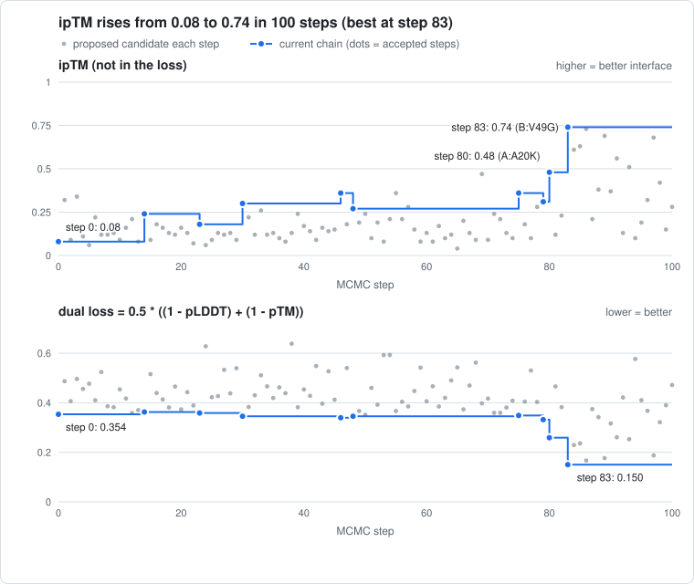
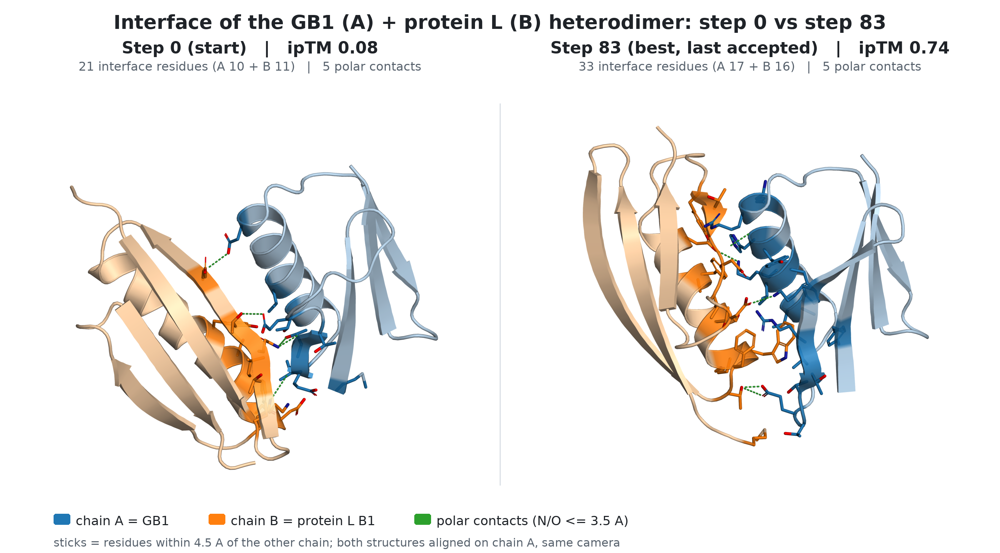

# Example 5: foldable alpha/beta heterodimer (GB1 + protein L B1), 100 MCMC steps

Start from two **foldable alpha/beta domains derived from natural proteins** instead of random sequences and let `af3-hall` build an interface between them while
keeping both folds. Config: [`../05_foldable_heterodimer_GB1_proteinL.yaml`](../05_foldable_heterodimer_GB1_proteinL.yaml).

```bash
af3-hall --config examples/05_foldable_heterodimer_GB1_proteinL.yaml      # real AF3, GPU
af3-hall --config examples/05_foldable_heterodimer_GB1_proteinL.yaml --mock   # CPU smoke test, seconds
```

## Key message



**ipTM went from 0.08 (the two proteins are not predicted to interact) to 0.74 in 100 steps, best accepted step 83.** ipTM is *not* in the loss
(`dual` = pLDDT + pTM only); it rises because the interface makes the complex confident. For 79 steps the chain crept along at ipTM 0.18-0.36 (7 accepted
steps), then two accepted mutations did most of the work: step 80 `A:A20K` (ipTM 0.48) and step 83 `B:V49G` (ipTM 0.74). Both folds were kept.



**The interface, step 0 vs step 83** (PyMOL, both aligned on chain A): the start has a loose contact (21 interface residues, 5 polar contacts); at step 83 chain B's helix packs against chain A's helix with a larger buried interface (33 interface residues). The number of polar contacts is unchanged (5), so the gain comes from packing, not extra hydrogen bonds.

| | Step 0 (start) | Step 83 (best, last accepted) |
|---|---|---|
| ipTM | 0.08 | **0.74** |
| pTM | 0.50 | 0.81 |
| pLDDT (mean, both chains) | 0.79 | 0.89 |
| ipSAE_min | 0.000 | 0.250 |
| `dual` loss (= J negated) | 0.354 | **0.150** |
| Helix / strand fraction, chain A | 0.27 / 0.25 | 0.27 / 0.23 |
| Helix / strand fraction, chain B | 0.23 / 0.34 | 0.22 / 0.38 |
| Chain-A atoms within 5 A of chain B | 44 | 88 |
| Sequence identity to start (A / B) | 100% / 100% | 82% / 91% |
| Cys / Pro / sequons | 0 / 0 / 0 | 0 / 0 / 0 |

First and last structures: [`step_0000_acc_AB_pos.cif`](step_0000_acc_AB_pos.cif) and [`step_0083_acc_AB_pos.cif`](step_0083_acc_AB_pos.cif).
Sequences (chain A = GB1, identical to PDB 1PGA; chain B = protein L B1 domain from PDB 1HZ6 with two substitutions, N14D to remove its NGS sequon and W47Y):

```
step 0   A  MTYKLILNGKTLKGETTTEAVDAATAEKVFKQYANDNGVDGEWTYDDATKTFTVTE
         B  MEEVTIKANLIFADGSTQTAEFKGTFEKATSEAYAYADTLKKDNGEYTVDVADKGYTLNIKFAG
step 83  A  MTYALILNGKTLKRRTTTEKVDAATAAKVFKHYAKRNGVDGEWDYDDGTKTFTVTE
         B  MEEVTIKANLIFADGVSLTAEFKGTFWKATSEAYAYADTLKKDNEEYTGDVADKGYTLNIKFAG
```

Accepted steps (9 of 100): 14 `B:S16V,T17S,Q18L` | 23 `A:K4A,E15R,T44D` | 30 `A:D36R,A48G` | 46 `A:Q32H,N35K` | 48 `A:G14R,E27A` | 75 `B:E27W,G45L` | 79 `B:L45E` | 80 `A:A20K` | 83 `B:V49G`.
Per-step table: [`steps_summary.tsv`](steps_summary.tsv) (candidate and current metrics, temperature, acceptance probability, seconds per step).

## Losses and weights

| Item | Value |
|---|---|
| Loss | `dual` = `0.5 * ((1 - pLDDT) + (1 - pTM))`, lower is better (`J = -loss`) |
| `loss_weights` | `1.0` (single loss) |
| State | one state `AB_pos` = A + B heterodimer, state weight `+1.0` (no negative states) |
| Acceptance | Metropolis on the loss, `margin: 0.0`, temperature `T = 0.01 * exp(-ln2 * step / 1000)` (0.0100 at step 1, 0.0093 at step 100) |
| Not in the loss | ipTM, ipSAE (logged only) |

## Options used

| Option | Value | Option | Value |
|---|---|---|---|
| `binder_seq` | GB1, protein L B1 (N14D, W47Y) | `mutation_rate` | `3-1` (3 mutations per step, decaying to 1) |
| `steps` | 100 | `mutation_method` | `frequency_adjusted` |
| `seed` | 0 | `mask_mode` | `all` (every position mutable) |
| `proposals_per_step` | 1 | `exclude_aa` | `CP` (no Cys, no Pro) |
| `num_recycles` | 1 | `forbid_sequon` | `true` |
| `num_diffusion_samples` | 1 | `T_init` / `half_life` / `temp_schedule` | 0.01 / 1000 / `exp` |
| `flash_attention` | `triton` | `backend` | `in_memory` (hot JAX session) |

## Runtime

AlphaFold 3 v3.0.1 on one NVIDIA A100 80 GB, shared with other users' jobs, `num_recycles: 1`, inputs padded to the 256-token bucket (120 residues).

| | |
|---|---|
| Whole run, 100 steps | **628 s (10.5 min)** wall clock |
| Step 0 (JIT compile + first fold) | 31 s |
| Steps 1-100 | median **5.9 s/step** (585 s total) |
| Accepted / proposed | 9 / 100 |

## Caveats

- One seed, one 100-step run: a demonstration, not a benchmark. The late jump (steps 80 and 83) is a stochastic event; other seeds will differ.
- ipTM and the loss are AlphaFold 3's own confidences on its own designs. There is no independent validation here (another predictor, MD or experiment).
- Secondary-structure fractions use biotite P-SEA on the CIFs (coarse). Sequences were used as listed in the YAML.

Files: `steps_summary.tsv` (per-step table), `iptm_loss_trajectory.svg` (regenerate with `python make_figure.py`), `interface_step0_vs_step83.png` (regenerate with open-source PyMOL: `pymol -cq make_interface_figure.py`, then `python compose_interface_figure.py`), the first and last CIFs above.
`af3-hall` always writes one CIF per accepted step to `<run>/trajectory/` (`--save-trajectory all` also keeps rejected candidates); only the first and last are kept here.
